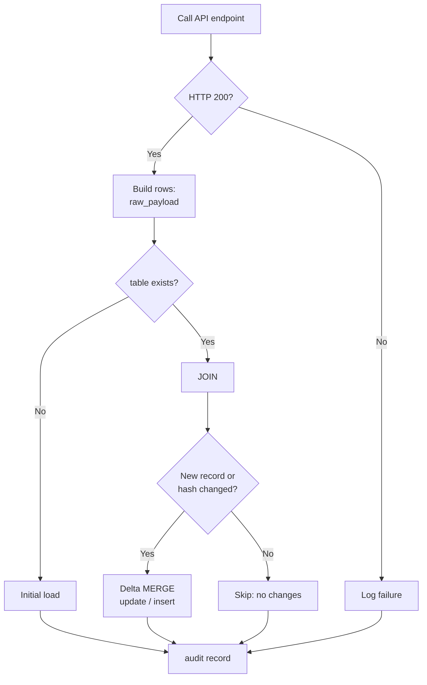

# 🏅 PlaceholderLakehouse

**An incremental Medallion Architecture (Bronze → Silver → Gold) data pipeline on Databricks, built with PySpark and Delta Lake, ingesting the JSONPlaceholder REST API.**


---

## 📌 Overview

PlaceholderLakehouse pulls data from five endpoints of the free [JSONPlaceholder](https://jsonplaceholder.typicode.com) API (`users`, `posts`, `comments`, `albums`, `photos`) and moves it through a three-layer lakehouse:

| Layer | Purpose | What happens |
| --- | --- | --- |
| 🥉 **Bronze** | Raw ingestion | Raw JSON is stored as-is in Delta tables, with a SHA-256 hash per record, ingestion metadata and API health metrics. Loads are **incremental** using Delta `MERGE`. |
| 🥈 **Silver** | Cleansed & conformed | JSON is parsed with explicit schemas, nested fields are flattened, columns are renamed and typed, duplicates removed, data quality flags added. |
| 🥇 **Gold** | Analytics-ready | Business aggregations: user activity, comments per post, albums per user, top album per user. |

---

## 🏗️ Architecture

```mermaid
flowchart LR
    subgraph SRC["🌐 Source"]
        API["JSONPlaceholder REST API<br/>/users · /posts · /comments<br/>/albums · /photos"]
    end

    subgraph BRONZE["🥉 BRONZE · main.bronze_jsonplaceholder"]
        direction TB
        B1["raw_users"]
        B2["raw_posts"]
        B3["raw_comments"]
        B4["raw_albums"]
        B5["raw_photos"]
        BA[("ingestion_audit_log")]
    end

    subgraph SILVER["🥈 SILVER · main.silver_jsonplaceholder"]
        direction TB
        S1["users"]
        S2["posts"]
        S3["comments"]
        S4["albums"]
        S5["photo"]
    end

    subgraph GOLD["🥇 GOLD · main.gold_jsonplaceholder"]
        direction TB
        G1["posts_per_user"]
        G2["comments_per_post"]
        G3["user_activity_summary"]
        G4["albums_per_user"]
        G5["photos_per_albums"]
    end

    API -- "requests.get()<br/>HTTP 200 check<br/>SHA-256 hash" --> BRONZE
    BRONZE -- "from_json() · flatten<br/>cast · dedupe · DQ flags" --> SILVER
    SILVER -- "joins · aggregations<br/>window functions" --> GOLD
    GOLD --> BI["📊 BI / Analytics"]

    style BRONZE fill:#f4e4d0,stroke:#cd7f32,color:#000
    style SILVER fill:#e8e8e8,stroke:#9a9a9a,color:#000
    style GOLD fill:#fff4c2,stroke:#d4af37,color:#000
```



### Bronze incremental load logic



---

## ✨ Key Features

- **Medallion architecture** on Unity Catalog (`main` catalog, one schema per layer).
- **Incremental ingestion**: each record gets a deterministic SHA-256 hash (sorted-key JSON), and only new or changed records are merged into Bronze via `DeltaTable.merge()`.
- **Ingestion audit log**: every endpoint attempt (including failures) records HTTP status, latency, record count, payload size, status and error message.
- **Schema-on-read in Silver**: explicit `StructType` schemas applied with `from_json`, nested JSON flattened (company, address, geo).
- **Data quality flags** on users: `VALID`, `INVALID_EMAIL`, `INVALID_GEO_LOCATION`, plus a derived `email_domain` column.
- **Deduplication** on the primary key for every Silver table.
- **Window functions** in Gold to find each user's album with the most photos.

---

## 🗂️ Data Model

### 🥉 Bronze: `main.bronze_jsonplaceholder`

| Table | Description |
| --- | --- |
| `raw_users`, `raw_posts`, `raw_comments`, `raw_albums`, `raw_photos` | Raw JSON in `raw_payload`, plus `record_id`, `record_hash`, `ingested_at`, `source_endpoint`, `http_status_code`, `response_latency_ms`, `payload_record_count`, `payload_size_bytes`, `ingestion_status`, `error_message` |
| `ingestion_audit_log` | One row per endpoint per run: `endpoint`, `ingested_at`, `http_status_code`, `response_latency_ms`, `payload_record_count`, `payload_size_bytes`, `ingestion_status`, `error_message` |

### 🥈 Silver: `main.silver_jsonplaceholder`

| Table | Rows (JSONPlaceholder) | Highlights |
| --- | --- | --- |
| `users` | 10 | Flattened company/address/geo, `data_quality_flag`, `email_domain` |
| `posts` | 100 | `post_id`, `user_id`, `title`, `body` |
| `comments` | 500 | `comment_id`, `post_id`, `commenter_email`, `comment_body` |
| `albums` | 100 | `album_id`, `user_id`, `title` |
| `photo` | 5,000 | `photo_id`, `album_id`, `url`, `thumbnailUrl` |

All Silver tables include `processed_at` and `source_endpoint`.

### 🥇 Gold: `main.gold_jsonplaceholder`

| Table | Description |
| --- | --- |
| `posts_per_user` | Total posts, comments received and unique commenters per user |
| `comments_per_post` | Comment count, unique commenters and commenter email set per post |
| `user_activity_summary` | Engagement dashboard: posts, comments, unique engaged users, average post length, latest post title |
| `albums_per_user` | Number of albums owned by each user |
| `photos_per_albums` | Each user's top album by photo count (ranked with `row_number()`), with average photo title length |

---

## 🚀 Getting Started

### Prerequisites

- A Databricks workspace with **Unity Catalog** enabled
- A cluster or serverless compute with permission to `CREATE CATALOG` / `CREATE SCHEMA` (or an existing `main` catalog)
- Outbound internet access to `jsonplaceholder.typicode.com`

### Run the pipeline

1. Import `Medallion_Architecture_JSONPlaceholder_API.ipynb` into your Databricks workspace (**Workspace → Import**).
2. Attach it to a cluster.
3. (Optional) Change the `CATALOG` value in the configuration cell.
4. Run all cells in order: **Bronze → Silver → Gold**.
5. Re-run the Bronze cell to see incremental logic in action: unchanged records are skipped (`New/changed records: 0`).

### Example queries

```sql
-- Most active users
SELECT name, total_posts, total_comments_on_posts
FROM main.gold_jsonplaceholder.user_activity_summary
ORDER BY total_comments_on_posts DESC;

-- Ingestion health
SELECT endpoint, ingestion_status, response_latency_ms, payload_record_count
FROM main.bronze_jsonplaceholder.ingestion_audit_log
ORDER BY ingested_at DESC;
```

---

## 🧰 Tech Stack

- **Databricks** (notebooks, Unity Catalog)
- **PySpark**
- **Delta Lake** (`MERGE`, ACID tables)
- **Python** (`requests`, `hashlib`, `json`)
- **Spark SQL**


---

## 📁 Repository Structure

```
PlaceholderLakehouse/
├── Medallion_Architecture_JSONPlaceholder_API.ipynb
└── README.md
```


